# `bdrive` CLI & sync engine — class diagram

Source of truth: `cmd/bdrive` (commands, gates) and `internal/{syncer,store,
journal,config,daemon,agenthooks,autostart}`; the `internal/remote` seam is drawn in
[webapp-server.md](webapp-server.md). Reflects the code as of this commit;
update this file in any PR that changes these types or their relationships.

## Sync engine — one cycle

```mermaid
classDiagram
    direction LR

    class Session {
        +Folder string
        +MountID string
        +Store *store.Store
        +Device config.Device
        +Account config.Settings
        +Backend remote.Backend
        +Note string
        +SessionID string
        +Prune bool
        +OnProgress func
        +Cycle(ctx) Result
        +CycleWithScanHint(ctx, hint) Result
        -cycleLocked(ctx, hint) Result
        -loadScope(ctx, st) scopeMoved
        -readOnlyPath / deniedPath
        -forgetPeerJournals()
        -preserveLocalEntry(abs, rel, fi)
        -firePostSync(res)
        -logInbound(rel, deleted)
        +Restore(ctx, path, sha) error
        -pushChunked(ctx, blob) bytes
        -fetchChunked(ctx, op, basis) error
        -chunkSpans(blob) []span
    }
    class ScanHint {
        +Full bool
        +Events []ScanEvent
    }
    class ScanEvent {
        +Path string
        +Kind ScanEventKind
        +Directory bool
    }
    note for ScanHint "Daemon-only local discovery hint. Nil keeps the full-scan compatibility path; empty skips local discovery while pull/materialize still run. Uncertain or overflowed batches force Full."
    ScanHint o-- ScanEvent
    Session ..> ScanHint : targeted local discovery
    note for Session "syncer also exposes LogEntries (causal order, what bdrive restore walks) plus CommitTime / DisplayTime / SortForDisplay — the order bdrive log prints: newest-first by when a change was journaled (CommitTime), tie-broken by the file's own write time (DisplayTime) so one scan reads by edit time"
    note for Session "Restore writes a historical blob back into the working folder as an ordinary edit (fetching it from the hub when this device never held it) — the next Cycle journals it like any other change; it takes no lock and appends to no journal itself"
    note for Session "internal/syncer — re-derive the clock → scan → commit local ops → pull peer journals → adopt on join → re-assert withdrawn ops → preserve conflicts → refresh rules → prune → materialize → push blobs then own journal"
    note for Session "The cycle OPENS by folding every op already in this volume's journal dir through absorbLamport. Nothing else re-derives st.Lamport — the pull absorbs only its NEW tail, and a settled peer journal yields none — so a device whose sync.json fell below the journals beside it stayed there forever, and since Less orders on lamport before time, every op it wrote lost replay: pushed for real, then overwritten by materialize in the same cycle (BEA-196). Derived AFTER `joining` is read, or a device whose first cycle crashed stops being a joiner and adoption changes"
    note for Session "pull returns TWO lists: newly seen ops, and `gone` — ops a peer deleted from a journal this device had already applied. A peer cannot un-say what we already hold: stillHold re-signs each still-held put into OUR journal (reassertNote). Pull resumes at a byte offset by prefix-matching the local journal copy, so a peer's growing journal is read once"
    note for Session "Bounds and hardening applied throughout: sizeBound/pullBound cap a fetch against the op's declared size, maxPeerJournals caps how many peers one cycle reads, absorbLamport/tickLamport refuse an absurd peer clock and saturate instead of wrapping, safeMode masks a materialized file to 0777 &^ 0022 (no setuid/setgid, no group/other write), and safeDevice + os.SameFile keep a peer's device id from naming this device's own journal file"
    note for Session "Cycle is now a thin wrapper: cycleLocked does today's work under the volume flock, then firePostSync spawns the folder's post_sync command AFTER the lock drops, so a hook that runs a bdrive command starts working instead of blocking on the flock the cycle still holds. Splitting the body out is what makes that a property of the code rather than a rule every call site remembers"
    note for Session "logInbound records each materialized peer path BOTH ways — onto Result.Inbound for the post_sync hook (same process as the cycle) and onto the store's inbound spool for bdrive sync --hook (a later process). DrainInbound is destructive and single-consumer: the hook must never drain it"
    note for Session "Prune (bdrive forget / sync --prune, never the daemon) journals a delete for every replayed path the SHARED ignore rules exclude — the include scope is per-device and must never prune it"

    class Result {
        +LocalOps +PulledOps
        +Conflicts +Adopted +Pruned +Materialized
        +ScanDuration time.Duration
        +ScanFull bool
        +Reverted []string
        +RetryPaths []string
        +Inbound []store.InboundEvent
        +Pushed +Offline +OfflineErr
        +ReadOnly +NoAccess +AccessErr
        +Reason() string
    }
    note for Result "Adopted counts the paths a JOINING device gave to the project (Cycle step 1b). A first cycle is a join, not an edit: a local file at a path the project already holds is demoted to lamport 0 (adoptNote), so the project's version wins on every device and no conflict copy is made — the local content stays journaled and pushed, which is what bdrive restore reads"
    note for Result "Inbound names the paths this cycle applied on a peer's behalf — what firePostSync hands the post_sync command as JSON on stdin. Empty on a scan-and-push cycle, which is why a local-edit-only cycle fires nothing"
    note for Result "Reverted names paths under a READ-ONLY FOLDER whose local edit this cycle put back from the hub, with the user's own version kept beside the file. Not a conflict: no op was written and no peer will ever see it, so it is a refusal, and bdrive sync names the files rather than counting them"
    note for Result "Offline / ReadOnly / NoAccess are three different answers: unreachable (retry all), push refused (pull-only), pull refused (pause, touch nothing)"
    note for Result "Reason() is accessReason(AccessErr): the hub's own sentence for a refusal, minus the wrapper chain, dropped unless it passes journal.SafeText. 'read-only' summarizes the STATUS CODE — the sentence is the only thing that tells a device-registration 403 from a project the user really is a reader on"

    class Filter {
        +Skip(rel) bool
        +SkipUp(rel) bool
        +PruneDir(rel) bool
        +AcceptRules(text) scope floor
        +RawIgnoreText() string
        +HasUpGuard() bool
    }
    note for Filter "ignore.go — .bdriveignore rules (incl. the managed `# bdrive scope` negation block written by init --only / bdrive scope) + a legacy .bdrive include list; Negated() is what makes sync --prune refuse on a scoped project. readRegularIgnoreFile loads only regular-file rules; walkFolder excludes a symlink at .bdriveignore, and materializeFile refuses peer links there. walkFolder also owns reserved-path pruning and nested-mount handoff"
    note for Filter "Folder permissions are separate from shared ignore rules: a read-only folder is materialized normally and never journaled. scan marks its entries seen without committing edits. Materialization preserves a dirty local file or link through preserveLocalEntry before applying the project version or deletion; clean peer updates create no local sidecar"
    note for Filter "The rules are NO LONGER symmetric. Skip governs materialize (download); SkipUp governs scan (upload) and adds the accepted-rules floor from AcceptRules: a pulled rule that NARROWS applies in both directions, a pulled `!` that WIDENS applies only downward — so a teammate editing .bdriveignore can never start uploading a file this device had excluded. .bdriveignore itself is always exempt. underMountOnDisk asks config.IsMount about each ancestor, so the project boundary no longer depends on what this walk happened to discover"
    note for Filter "EscapeIgnore is compile's inverse (escapes the glob metacharacters, the negation and comment markers, and trailing whitespace) so bdrive forget writes a rule matching exactly that path and nothing else"

    class SyncState {
        +string Remote
        +string Device
        +Lamport +PushedOps +Access
        +AccessReason
        +IgnoreAccepted +IgnorePulled
        +ReadOnly +Denied +ScopeTag
    }
    class Scoper {
        <<remote — optional capability>>
        +Scope(ctx) Scope
    }
    class Scope {
        +Tag string
        +ReadOnly slash-terminated prefixes
        +Deny slash-terminated prefixes
    }
    note for SyncState "Access/AccessReason are written ONLY by the leg that asked the hub — pull clears no-access, push records read-only or clears it. A cycle with no remote leg leaves the last answer standing, so the daemon's local-only ticks stop alternating 'read-only' / 'access restored' and bdrive status stops reporting healthy sync moments after a refused push"
    note for SyncState "ReadOnly/Denied/ScopeTag are the hub's folder-permission answer, PERSISTED so an unreachable hub keeps the last scope instead of widening to &quot;everything is writable&quot; and building a journal the hub refuses whole when it returns. A ScopeTag that moved means this account's view changed, so forgetPeerJournals drops every peer copy: the hub serves each peer journal filtered, and pull skips a journal that did not grow and otherwise resumes at a BYTE OFFSET — so a revocation would silently stop that peer being read forever"
    note for Scoper "In the PutSigner mold: a hub knows about folder permissions, a raw object store has no account to answer for and does not implement it. ErrNoScope (a hub too old to have them) means &quot;nothing is restricted&quot; and clears a stale list; a transport error means keep the last answer. sanePrefixes drops what the hub sends that this device will not act on — an empty prefix matches every path and would stop the device syncing its own work, silently"
    note for SyncState "store — IgnoreAccepted is the .bdriveignore scope THIS device consented to; IgnorePulled is the text a peer's version last wrote here. The pair is what tells a locally authored rule change from one that arrived over the wire. vouchedFloor seeds it once on upgrade: keep every exclusion, drop each `!` that no already-materialized path vouches for"

    class SafePath {
        <<internal/journal — one rule>>
        +SafePath(p) bool
        +SafeText(s) bool
    }
    note for SafePath "The single text/path rule for the whole repo, replacing three drifting copies. SafePath: relative, clean, no .., not absolute. SafeText: no C0/C1/DEL, no Unicode Cf format chars (bidi overrides, tag block), no U+2028/9 — applied to Note/Author/UserName too, since those are rendered. Both hub ingest doors and the CLI's own terminal output now answer to it"

    class ReservedPath {
        <<internal/config — one rule>>
        +ReservedDir(name) .git .bdrive
        +ReservedName(name) .DS_Store, tmp
        +AgentHookConfig(p) bool
        +AgentConfigDir(name) bool
        +ReservedPath(p) bool
    }
    note for ReservedPath "Case-and-trailing-dot folded, so `.BDRIVE.` is still reserved. AgentHookConfig names the files an agent EXECUTES (.claude/settings.json, .codex/*, .gemini, .hermes, .mcp.json at any depth) — a synced project must never be able to hand a teammate's agent new hooks. Deliberately its own list, not derived from internal/agenthooks: config imports nothing. AgentConfigDir answers about ONE segment, for init's mount-root gate: the reserved rule only sees segments BELOW a root, so mounting ~/.claude itself leaves settings.json a bare top-level file"

    class UnderRoot {
        <<internal/store — one rule>>
        +UnderRoot(root, p) bool
        +OpenRegularUnderRoot(root, abs)
    }
    note for UnderRoot "path.go — UnderRoot checks symlink-aware containment for materialized writes, the file:// backend, templates, scope files and init's BDRIVE_HOME gate. OpenRegularUnderRoot pins the mount root descriptor and walks every descendant with no-follow Openat calls; the leaf is nonblocking and descriptor-validated as regular. grep, stale and ignore-rule reads cannot follow a concurrently swapped parent outside the mount. Symlinked mount roots remain valid; ErrNotRegular classifies only leaf non-regular entries"

    class walkFolder {
        +walkFolder(folder, filter, fn)
        +walkFolderPathsFast(folder, filter, roots, fastUnchanged, onWalkErr, fn)
        +syncsEntry(verdict) bool
        verdict: vSync vSymlink vSkipFile vDescend vPruneDir vNested
    }
    note for walkFolder "walk.go — the shared sync predicate for scan, Explain, Measure, SyncedFiles and Drift. syncsEntry accepts regular files and symbolic links; the walker classifies a symlink at .bdriveignore as skipped because sync policy must be regular-file content. walkFolderPathsFast adds an unchanged-cache shortcut when the mount's ignore fingerprint matches the last full scan"

    class Measure {
        +Measure(folder, include) files, bytes
    }
    note for Measure "walk.go — sizes what a FIRST sync would upload, for the oversized-folder warning bdrive init prints (1 GiB / 20k files). Filter-aware on purpose: a 40 GB repo whose bulk is already ignored measures as the few MB that really sync, so the warning fires on the folder nobody meant to share and stays quiet on an ordinary checkout. Advice only — an unreadable subtree is skipped, never fatal"

    class SyncedFiles {
        +SyncedFiles(folder, include, accepted) paths
    }
    note for SyncedFiles "walk.go — the mount-relative paths that sync, in walk order: what bdrive grep searches, so a .bdriveignore rule or a narrowed scope excludes a file from search exactly as it excludes it from sync. Deliberately NOT Explain, which countFiles every pruned dir — a grep in a repo with node_modules/ would walk it in full for a count it discards"

    class Drift {
        +Drift(folder, include, accepted, cache) added, modified, removed
    }
    note for Drift "drift.go — the local line in bdrive status: compares entry types and size+mtime fingerprints against the materialization cache. A link with a changed fingerprint counts as modified only when its target changed; a same-target touch stays quiet. Pure read: stores no blob, mints no op and never mutates the cache"

    class Explain {
        +Explain(folder, include, accepted) two lists
        +NotSyncedFiles(entries) int
    }
    note for Explain "`accepted` is SyncState.IgnoreAccepted, passed in rather than loaded: Explain opens no volume store, but it must install the same floor SkipUp uses or --explain would describe an upload set that never leaves. bdrive scope reads it best-effort and degrades to no floor"
    class Entry {
        +Path string
        +Files int
        +Nested bool
    }
    note for Explain "explain.go — bdrive scope --explain. Pure read: own Filter, no Session, no flock, no network. Collapses fully-excluded dirs to one counted line; nested mounts annotated, counted as zero (they sync via their own project)"

    class Store {
        -dir volume dir
        +PutBlob / PutBlobFileVerified / MaterializeBlobToTemp / OpenBlob / HasBlob
        +PruneLocalBlobs / PruneLocalBlobsForDevice
        +AppendOps / DeviceOps / AllOps / JournalPrefixAt
        +ReplayFold() FoldResult
        +OwnOpCount / OwnOpsFrom
        +FoldPeerAppend / EvictPeerJournals
        +IgnoreFingerprintMatches / SetIgnoreFingerprint
        +LoadCache / LoadCacheReadOnly / SaveCache mountID
        +HasCache mountID
        +LoadSync / SaveSync / SyncStateEqual
        +SaveNote / LoadNote
        +LogRead(rel, session) read spool
        +PendingReads dedup on path+session
        +LogInbound / DrainInbound
        +LogInboundForMount / DrainInboundForMount
        +LoadSecrets / SaveSecrets mountID
        +Lock() / TryLock() flock
    }
    note for Store "secrets-mount-id.json is the credential-finding record: what `bdrive status` prints and what the agent hook appends a sentence about. Like the inbound spool it outlives the cycle that wrote it — the daemon scans the write seconds before the turn starts — but unlike it, it is STATE and is never drained: a finding stands until the file changes without it"
    note for Store "internal/store: ~/.bdrive/volumes/volume-id holds shared content-addressed blobs, per-device journal copies, and sync.json; state-mount-id.json, paused-mount-id, note-mount-id.json, secrets-mount-id.json, and inbound-mount-id.jsonl are per-mount (free funcs Paused/SetPaused and PausedMount/SetPausedMount, no flock)"
    note for Store "inbound-mount-id.jsonl (with legacy inbound.jsonl fallback) is the read spool's twin, running the other way: materialize appends every path it wrote or removed for a peer, and `sync --hook` drains it into the turn's context (re-read before editing). Appends and the drain share an flock on the spool's .lock sidecar, since the drain runs outside the volume lock beside a daemon that may be appending. A spool and not a Result field because the daemon usually materializes the change seconds before the turn starts, so the hook's own cycle sees nothing. Capped, best-effort, never fails a cycle. Result.Inbound now carries the SAME events for the post_sync hook and is not a duplicate to delete: that consumer fires from the cycle itself, and a second drainer would silently empty the agent hook's context"
    note for Store "The fold-cache keeps the replayed target, op count, lamport high-water mark, and ignore winner together; ReplayFold reuses unchanged journal folds instead of re-reading and sorting every device on every cycle. LoadCacheReadOnly supplies the immutable map used by echo suppression without cloning large mount caches."

    class secretLog {
        <<syncer/secrets.go>>
        found map path to Findings
        dirty bool
        +scanBlob(store, rel, sum)
        +set / drop per path
    }
    note for secretLog "internal/secrets' six rules, run on the path EVERY file takes. Only on the branches that just called PutBlobFile — the cheap size+mtime path never re-reads a file — and it reads the BLOB, i.e. the exact bytes that were hashed and journaled, so a line number can never describe content no op captured"
    note for secretLog "WARN ONLY: the op is journaled and pushed exactly as before. Holding it would strand the file behind a false positive and break the cycle's degrade-to-offline posture. Merged PER PATH into secrets-mount-id.json and written in finish only when dirty — nearly every cycle scans zero files, so a whole-set rewrite would erase the warning seconds after it appeared. A save error is logged, never returned: advisory telemetry gets no veto over convergence"

    class Op {
        +Seq +Lamport +Time +Device
        +Author +User +UserName
        +Kind put or delete
        +Path +Blob +Base +Size +Mode +Note
        +Link symlink target, no blob
        +Session agent session, hook-set
        +Mtime when the file was written
    }
    note for Op "internal/journal — Less orders by (lamport, time, device, seq), capped at MaxValidLamport; Replay folds to LWW-per-path state in a single O(N) pass; ParseWithCheckpoints decodes large journals in parallel across newline-aligned chunks and records sparse byte offsets; each device writes only its own journal. Mtime is display-only (bdrive log shows it, falling back to Time) and never feeds Less or Replay. Session holds the same standing: set only by `bdrive sync --hook` (never by --note, which any member can spell), display/join-only, and the key History run cards group on — a note is forgeable, a session id is not"
    note for Op "Link (put only) marks a symbolic link: the target string verbatim and NO blob — the scan uses Readlink, never Open, so a link to ~/.ssh/id_rsa journals eleven characters and not one byte of the key. Replay carries it into FileState.Link; materializeSymlink recreates the link entry on peers and never resolves it; a link pointing outside the mount is an ordinary op that only the user's own filesystem ever follows. walkFolder answers vSymlink for it, so Explain, Measure and Drift see the same thing scan does"
    note for Op "Op now owns its own JSON: a Path that is not valid UTF-8 rides as a base64 `path_raw` sidecar and is restored only when the lossy form still matches, so one line can never name two different files on two readers. Less falls through to Kind/Path/Blob/Size/Mode, making the order TOTAL — two ops can no longer tie and replay differently per device. Parse skips an undecodable line and drops an unknown Kind instead of failing the whole journal"

    class Manifest {
        +V int
        +Size int64
        +Chunks []chunkRef h, n
    }
    note for Manifest "chunks.go — delta sync. Files over chunkThreshold (4 MiB) push as content-defined chunks (restic/chunker, fixed Rabin polynomial, 256K/1M/4M) under chunks/sha256 plus this manifest under manifests/file-sha — keyed by Op.Blob, so the JOURNAL FORMAT IS UNTOUCHED. pushChunked skips a chunk only when the remote CONFIRMS holding it (one Exists per chunk): three cheaper proxies — local basis, manifest existence, stored manifest content — each proved false or forgeable, and the code comment records why. A refused manifest (write-once 409, ingest 400) falls back to pushing the whole blob, so chunker parameters are not load-bearing. fetchChunked assembles from the manifest, sourcing unchanged chunks from the basis blob already in the local store (cache[path].Blob), verifying the whole against Op.Blob via PutBlobReader; any failure falls through to the whole-blob path, gated on Exists so a transient chunk blip does not trigger hub reassembly every tick. Local blobs stay whole — chunking exists only on the wire and in the remote"

    class Backend {
        <<interface>>
        +Put +Get +List +Exists +Close
        +ErrForbidden sentinel
    }
    note for Backend "internal/remote — client devices use the https:// hub backend (token from BDRIVE_TOKEN / settings.json); a hub 403 wraps ErrForbidden, which is what Result turns into ReadOnly/NoAccess instead of Offline"

    class merge {
        <<internal/syncer, merge.go>>
        +tryMerge(path, mine, theirs, all) blob, ok
        +mergeText(base, a, b) out, ok via textmerge
        +commonAncestor(path, mine, theirs, all)
        +latestPut(path, blob, lists) op, ok
        -maxMergeBytes 4 MiB, UTF-8 only
    }
    note for merge "conflictCopiesWithState merges the losing op against the op that WON (latestPut: the greatest put holding the blob replay resolved to), fetching that blob first when it is not local. Lineage is never guessed from Base links. When the merge yields exactly the winner's bytes (merged blob == cur.Blob), the winner already holds both sides: another device or the hub merged first, so the cycle fast-forwards and writes no op. A real merge is journaled with Op.Base = the winning blob."
    class textmerge {
        <<internal/textmerge>>
        +Merge(base, a, b) out, ok
        +DiffHunks(old, new) []CharHunk
        +RetainsChanges(base, candidate, head) bool
        +IsText(b) bool
    }
    note for textmerge "Each side is diffed against the base with a Myers O(ND) line diff, so a side that touched several places yields several small hunks. Non-overlapping hunks apply independently (diff3). Overlaps resolve only for an identical edit, same-point insertions (ordered by content, never argument position), and one line both sides edited in different words (a token-level merge3). Everything else stays a conflict. DiffHunks gives minimal UTF-16 splices for a CRDT; RetainsChanges proves a later head still carries an earlier edit."

    class daemon {
        +Run(folder, scan, remote)
        +Start / Stop / Running
        +GlobalRunning / WakeSupervisor
        +GlobalLockPath / GlobalPidPath / GlobalLogPath
        +EnsureRunningBestEffort / EnsureRunningAsync
        -map~string, volumeWorker~ workers
    }
    note for daemon "One detached bdrive daemon run supervisor per machine/user session. Holds BDRIVE_HOME/daemon.lock, with daemon.pid and daemon.log beside it. Reconciles valid, unpaused mounts into one worker per volume; exits cleanly when no active volumes remain"
    note for daemon "init, resume, sync, status &lt;folder&gt; and agent sync hooks start or wake the supervisor for unpaused projects. A binary fingerprint change replaces the old supervisor. Hook self-heal is asynchronous"

    class volumeWorker {
        -string expectedRemote
        -context.CancelFunc cancel
        -chan wakeCh
        -chan done
    }
    note for volumeWorker "runVolumeWorker cycles all enrolled worktrees sharing volDir and holds volumes/volume-id/daemon.lock; daemon.pid and daemon.log stay per-volume. Re-reads config each tick, promotes a live sibling or exits without deletes if a folder vanishes. A changed remote ends the worker"
    note for volumeWorker "bdrive stop pauses the selected mount; stop --all pauses every enrolled project on the device. When no active sibling remains, its worker releases the volume lock; other projects keep running. The global and volume flocks form the Dual-Lock scheme"
    class localFolderWatcher {
        -chan wake
        -chan err
        +close()
        +take(root) localWatchBatch
        +fence() sequence
        +suppress(root, fence, keep)
    }
    note for localFolderWatcher "The watcher accumulates bounded per-mount events, coalesces paths, prunes reserved/nested/ignored directories, and evaluates echo suppression outside pendingMu without loading the state cache when no pre-fence events are pending. Child ENOENT during recursive setup triggers candidate rebuild (releasing the prior watcher first on EMFILE/ENFILE/ENOSPC) and full-scan fallback when roots still exist; ENOSPC watcher exhaustion is retried with 1m/2m/5m/10m backoff and duplicate errors are logged once. Missing roots, closed channels, overflow and other backend errors remain fatal."
    volumeWorker --> ScanHint : routes per-mount event batches
    ScanHint ..> localFolderWatcher : batch source
    note for Session "Concurrent edits to different parts of one text file MERGE now instead of forking. conflictCopies tries a three-way merge first (merge.go): the common ancestor is the greatest op for that path ordered before BOTH sides, which the journal already holds. It declines far more than it resolves — no ancestor, non-UTF-8 or NUL, over 4 MiB, an unreadable blob, or two different rewrites of the same words all fall through to exactly the conflict copy that existed before, because a machine guessing between two rewrites of one sentence is how people lose work quietly. Only non-overlapping hunks (or, within one line, non-overlapping words) are ever taken, and every tie is broken by content, which makes merge(base,a,b) equal merge(base,b,a) — the property that lets two devices each observe the same concurrency and merge independently without pushing different blobs. Result.Merged is counted apart from Result.Conflicts: a merge is work the machine finished, a conflict is work it handed back. An EMPTY version never forks and never keeps a path: an empty loser is not preserved at all, and content that lost to an empty winner is put back at the real path (keptOverEmptyNote, counted as Merged) — a truncated save or a failed read written back is almost never an edit anyone meant, and a copy beside an empty file leaves the reader the empty one"

    note for volumeWorker "remote.Watcher wakes a remote cycle when a peer pushes, reducing arrival latency from about 10s to 1s. A live stream stretches polling to remoteInterval x watchedPollFactor (5m by default); losing it restores remoteInterval on the next tick. Token changes and offline cycles drop the stream. Failed or ended dials back off for watchRetry (1m), including an older hub's 404. Periodic polling still bounds silent stream failure."
    class pulledVouch {
        -[]string mounts
        -remote.StreamLiveness stream
        passed / withdraw / streaming / renew
    }
    note for pulledVouch "Keeps the volume's pulled marker (store.MarkPulled: pid + mounts) honest for the agent hooks: written after a tick that pulled every mount (passPulled, with no announcement queued), renewed every 5 s while the hub's change stream is alive (remote.StreamLiveness: any frame, keepalives included, within 30 s), withdrawn on a peer announcement, a failed remote pass, or worker exit. Renewal is what covers the stream-paced polls, which are minutes apart"
    volumeWorker *-- pulledVouch : vouches for the agent hooks
    note for volumeWorker "A healthy local watcher gets a 5m safety scan. When it is unavailable, local fallback polling adapts to the last full scan duration (up to 1m, with a 15x multiplier) while remote polling and SSE wakes remain on their independent cadence. Changes to Include or .bdriveignore rebuild the watcher before the next wait."
    class rawWatcher {
        <<interface>>
        +Add(dir) error
        +ForgetPrefix(prefix)
        +Recursive() bool
        +Events() chan Event
        +Errors() chan error
        +Close() error
    }
    class fanotifyRaw
    class fseventsRaw
    class fsnotifyRaw
    volumeWorker --> localFolderWatcher : local filesystem wake and safety fallback
    localFolderWatcher *-- rawWatcher : active backend
    fanotifyRaw ..|> rawWatcher : Linux primary
    fseventsRaw ..|> rawWatcher : macOS primary
    fsnotifyRaw ..|> rawWatcher : fallback / default
    note for localFolderWatcher "Platform backends prefer unprivileged fanotify (FAN_REPORT_DFID_NAME) on Linux with fsnotify/inotify fallback, FSEvents on macOS with fsnotify/kqueue fallback, and fsnotify on other platforms. Unsupported or resource-exhausted backends fall through the chain; a healthy backend is still only an accelerator over safety polling."
    localFolderWatcher ..> Filter : PruneDir on watched trees

    Session --> merge : before a conflict copy
    merge --> textmerge : the line merge itself
    Session --> Store : volume state
    Session --> Backend : pull and push
    Session --> Manifest : chunked push and pull, files over 4 MiB
    Session --> Filter : SkipUp on scan, Skip on materialize
    Session --> walkFolder : scan
    Explain --> walkFolder : same predicate
    Drift --> walkFolder : same predicate
    Drift --> Filter : own fresh instance
    SyncedFiles --> walkFolder : same predicate
    SyncedFiles --> Filter : own fresh instance
    Measure --> walkFolder : same predicate
    Measure --> Filter : own fresh instance
    Explain --> Filter : own fresh instance
    Explain ..> Entry : not-synced lines
    walkFolder --> Filter : SkipUp / PruneDir / addNestedMount
    Session --> secretLog : scan flags, finish persists
    secretLog --> Store : reads the blob, writes secrets-mount-id.json
    Session ..> Op : commits, replays
    Session --> Result
    Store o-- Op : journal files
    Store *-- SyncState : sync.json
    Session --> SyncState : reads the floor, records what it accepted
    Scoper <|.. Backend : the hub backend answers, a raw bucket has no account to answer for
    Session ..> Scoper : loadScope, once per cycle before scan
    Scoper ..> Scope : tag + readonly + deny prefixes
    Scope ..> SyncState : persisted, so an unreachable hub never widens
    SyncState ..> Filter : AcceptRules(IgnoreAccepted)
    Session ..> SafePath : every path and note, in and out
    Session ..> UnderRoot : materialize writes and deletes
    walkFolder ..> ReservedPath : never-sync set
    Session ..> ReservedPath : neverSync = unsafeRel or reserved
    daemon *-- "0..*" volumeWorker : workers keyed by volDir
    volumeWorker --> Session : one Cycle per tick
```

## CLI commands, device state, and the opt-in gate

```mermaid
classDiagram
    direction LR

    class Commands {
        init login logout
        sync stop(--all) scope grep stale forget status log
        restore url share comments export import
        web desktop daemon hooks read-log
        resume autostart mcp
    }
    note for Commands "mcp list / mcp revoke &lt;id&gt; is the terminal half of the hub's Connected agents page — the same /api/mcp/grants routes, reached with the saved device token. A revocation is a security control, so it must not depend on a browser being available"
    note for Commands "desktop is hidden and spawned by the BearDrive Desktop app: a loopback-only webapp.Server over this machine's volume stores (Desktop:true ⇒ PermRead for everyone), with sync control, sign-in and onboarding under /api/desktop/*"
    note for Commands "desktopRoutes classifies every per-project hub route as local (with a required reason) or proxied, and desktopHandler REGISTERS FROM IT — so &quot;classified as proxied&quot; and &quot;actually proxied&quot; cannot drift. It exists because the desktop mux falls through to a local server, which makes forgetting a route invisible: the local registry answers plausibly and wrongly. TestDesktopRoutesClassified fails on any hub route not listed, reading the hub's own list from webapp.APIRoutes"
    note for Commands "comments lists the hub's review threads (GET /api/p/&lt;id&gt;/comments) and acts on them (reply / resolve / reopen, any unique id prefix). The one thing it adds over the API is LOCAL: locateQuote finds each thread's quoted text in this device's copy of the file — both sides reduced to what survives rendering (no whitespace, markdown emphasis characters or tags, entities decoded, case folded), the occurrence whose recorded prefix/suffix agree best wins — and prints path:line, so an agent goes straight to it. Every comment string is reviewer-authored and goes through safeField line by line"
    note for Commands "cmd/bdrive — thin cobra layer; init is the front door (one command: login + hooks + sync + link), stop pauses"
    note for Commands "grep searches file CONTENTS in the working folder via syncer.SyncedFiles — LoadProject not ResolveMount (a read must not enroll the device), no session, no flock, and the volume store is opened only if it already exists, so a search creates nothing. Exit 1 on no match is a status, not an error (errNoMatch + SilenceErrors). stale copies that whole posture and swaps the predicate: it extracts path-shaped references from synced markdown, keeps only the ones resolving into the SyncedFiles set, and flags a doc whose reference was written later. It dates a path from the JOURNAL, not os.Stat — materialize stamps a peer's file with this device's mtime, so mtime comparison reports nothing on a freshly cloned machine — folding st.AllOps() to the max syncer.DisplayTime per path, which drops a forged future stamp instead of dating that path to year 1. Unlike grep it exits 0 either way: advisory output, not a gate"
    note for Commands "Every peer-authored string status / log / whoami print goes through safeField first — a teammate's file name is attacker-controlled text landing in your terminal, and an escape sequence there rewrites the line above it. grep runs BOTH the path and the matched line through it — a matched line is a teammate's file content, the widest version of that surface. login now does PKCE on the loopback callback (no compat arm) and both its client and init's refuse to follow a redirect off the hub's origin with the device token attached"

    class Templates {
        <<internal/templates>>
        go:embed all:files — docs, wiki, para, skills
        List / Get / Names
        WriteTo(dir) skips existing paths
    }
    note for Templates "The embed directive is `all:` — a plain pattern drops dot-prefixed paths silently, and the skills template IS .claude/skills/<name>/SKILL.md. init --template <name>: refused with --only and on an unknown name BEFORE any write. The hub seeds at creation (the CLI creates through POST /api/projects), so WriteTo runs only as the fallback for a hub too old to know the field, and in an already-initialized folder — the agent's post-init path. Skipping existing paths is what makes a double-seed a no-op"

    class syncBlocked {
        <<gate>>
        enrolled in mounts.json?
        volume not paused?
    }
    note for syncBlocked "cmd/bdrive/helpers.go — sync, sync --hook, and read-log must pass it; reads the registry WITHOUT ResolveMount's enrolling self-heal. Hook mode fails silent; plain sync errors with a bdrive init pointer"

    class openSession {
        mustProject → ResolveMount
        store.Open + remote.Open
    }
    class startSync {
        enroll + clear paused
        initial Cycle
        daemon.Start
    }
    note for startSync "cmd/bdrive/sync_run.go — init's engine; the ONLY enroller and the only thing that resumes a pause"

    class Project {
        +ID stable mount id
        +Volume +Remote
        +Include legacy, read-only
        +PostSync local hook command
    }
    note for Project ".bdrive/config.json — travels with the folder (git clone, copy); presence alone is NOT consent to sync"
    note for Project "PostSync is a shell command this device runs after a cycle applies peers' changes. It lives here and ONLY here: .bdrive is in ReservedDirs and never syncs, so no hub and no teammate can put a command on someone else's machine. The daemon re-reads this file every tick, so an edit takes effect without a restart"

    class Workspace {
        .bdrive/workspace.json
        +Kind = "workspace"
        +Projects path + id
        +HasManifest(dir) stat only
        +IsWorkspaceRoot(dir) READS
        +DesignateWorkspace / UndesignateWorkspace
        +RefreshWorkspace / RefreshWorkspaceOf
    }
    note for Workspace "internal/config/workspace.go — a folder that HOLDS projects rather than being one; the desktop app writes it at the folder you connect, the CLI never creates one. An INDEX, never a source of truth: identity stays in each project's own config.json, so a wrong or stale entry costs nothing and every daemon start rewrites the list from what is on disk. Deleting the file un-roots the folder"
    note for Workspace "The blocking boundary is the whole design. HasManifest is a STAT and can be called anywhere; IsWorkspaceRoot OPENS the file and can block forever on a FIFO, a dead network mount, or a TCC prompt with nobody to answer. So IsWorkspaceRoot has exactly ONE production caller — RefreshWorkspace — whose only caller is the daemon's goroutine, where blocking is affordable. Everything on a hot path (init, share, the agent hook guard) uses HasManifest. The read is bounded to 1 MiB anyway"
    note for Workspace "The manifest is workspace.json, NOT config.json with a kind field: the agent hook guard walks up looking for .bdrive/config.json to decide 'am I in a project', and a root carrying that name would answer yes for every folder beside it. It lives under .bdrive, which is in ReservedDirs, so it never syncs at any depth. A root is never a mount — LoadProject rejects the workspace kind, and init refuses both a root and a folder containing one"

    class MountRegistry {
        mounts.json
        id → Path Volume Remote
        + Dev + Ino directory identity
        +ResolveMount read and self-heal
        +EnrollMount writes the row
        +ValidMountID(id) bool
    }
    class MountInfo {
        +string VolumeID
    }
    note for MountRegistry "ResolveMount and EnrollMount are now two gestures, not one. ResolveMount NEVER creates a row: it self-heals the path only when Dev/Ino prove it is the same directory (a move), so a COPY of a project folder no longer silently enrolls itself as the original and starts writing that project's journal — it errors and points at bdrive init. EnrollMount is ResolveMount plus the write, and startSync is its only caller. ValidMountID keeps a hand-edited id out of a filesystem path (it names a directory under BDRIVE_HOME)"
    class Device {
        device.json
    }
    class Settings {
        settings.json
        server + token + account
    }
    note for MountRegistry "internal/config — per-device state under BDRIVE_HOME, which Home() now absolutises and ensureHome() creates 0700 (and tightens if an older version left it 0755): device.json, settings.json and every volume live there"

    class AgentHooks {
        Detect / Install / Uninstall / Registered
        ConfigPath = USER config
        turn-start: sync --hook
        post-edit: sync --defer --note
        post-read: read-log
    }
    note for AgentHooks "internal/agenthooks — registers per-platform hook commands (claude, codex, gemini, hermes) in each platform's USER config, once per machine; they fire in every folder, every turn, and no-op outside mounts"
    note for AgentHooks "Beside a daemon that vouches for the mount the sync hooks skip their cycle (a full walk on every turn and edit): sync --hook drains the inbound spool and reads secret findings, sync --defer only saves the note. Vouching = daemonCurrent: the hook takes the volume lock within 5 s (store.LockWithin, so a cycle in flight finishes first) and, holding it through its reads, finds the pulled marker under 15 s old, written by the pid holding the daemon lock, listing its mount. Otherwise both run a full cycle; --defer refuses --prune"
    note for AgentHooks "config.AgentHookConfig is the OTHER half of this story and deliberately NOT this package: it names the files an agent READS hooks from, so sync refuses to carry them. A teammate must never be able to push .claude/settings.json into your mount and have your next turn run their command. The two lists are kept apart on purpose — one is what we write, one is what the agent executes — and internal/config imports nothing to say it"

    class PausedMarker {
        volumes/id/paused
        volumes/id/paused-mount-id
    }
    note for PausedMarker "set by bdrive stop, cleared only by bdrive init (startSync)"

    class Autostart {
        Install / Uninstall / Installed / Path
        launchd | systemd | HKCU Run
        ErrUnsupported (BSD, no-systemd)
    }
    note for Autostart "internal/autostart — ONE login unit per machine that runs `bdrive resume`: darwin a LaunchAgents plist (RunAtLoad, no KeepAlive), linux a systemd user unit + its default.target.wants symlink (needs sd_booted), windows an HKCU Run value. Writes the registration only — never launchctl/systemctl/schtasks"

    class GlobalDaemonLock {
        BDRIVE_HOME/daemon.lock
        BDRIVE_HOME/daemon.pid
        BDRIVE_HOME/daemon.log
    }
    note for GlobalDaemonLock "Held for the supervisor process lifetime. GlobalRunning checks the flock; WakeSupervisor sends SIGHUP to its recorded PID. No active volumes means a clean exit"

    class DaemonLock {
        volumes/volume-id/daemon.lock
        volumes/volume-id/daemon.pid
        volumes/volume-id/daemon.log
    }
    note for DaemonLock "Held for the volume worker lifetime. Running(volDir) checks the flock. Start waits for the worker lock; stopping a project reconciles workers instead of killing their shared process"
    note for DaemonLock "Liveness comes from the flock, never daemon.pid. The PID used for signalling is stored inside the held lock and cleared on release. Lock files use O_NOFOLLOW. The kernel releases both lock levels on process death or reboot"

    Commands --> Autostart : autostart install/uninstall (init runs install automatically)
    Autostart ..> Commands : login runs `bdrive resume`
    Commands --> daemon : Start / Stop / Running and self-heal
    daemon --> GlobalDaemonLock : supervisor owns
    volumeWorker --> DaemonLock : worker owns
    daemon --> MountRegistry : discovers valid unpaused volumes
    daemon --> PausedMarker : reconciles active workers
    startSync --> daemon : starts or wakes supervisor
    Commands --> AgentHooks : hooks install/uninstall (init runs install automatically)
    AgentHooks --> Commands : runs sync and read-log
    Commands --> syncBlocked : sync and read-log gate first
    syncBlocked --> MountRegistry : reads only, never enrolls
    MountRegistry *-- MountInfo : rows
    syncBlocked --> PausedMarker : Paused check
    Commands --> openSession : after the gate
    openSession --> MountRegistry : ResolveMount — self-heal only, never enrolls
    Commands --> Templates : init --template (seed) / init resume (agent's post-init path)
    Commands ..> ReservedPath : init refuses an AgentConfigDir mount root
    Commands --> startSync : init
    startSync --> MountRegistry : EnrollMount — the only writer
    startSync --> PausedMarker : clears
    Commands --> PausedMarker : stop sets
    openSession ..> Project : loads
    openSession ..> Device : identity
    openSession ..> Settings : account and token
    Commands ..> Workspace : init refuses a root, desktop onboarding designates one
    volumeWorker ..> Workspace : RefreshWorkspaceOf, the only manifest reader
    Workspace ..> Project : indexes them, never owns their identity
```


